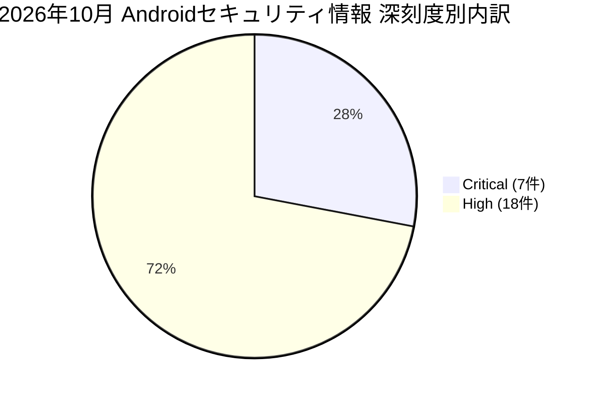

# 全体像
- 総件数: 25件
- 深刻度別の件数: Critical: 7件 / High: 18件
- コンポーネント別の件数内訳:
  - Framework: 7件 (Critical: 1件 / High: 6件)
  - System: 18件 (Critical: 6件 / High: 12件)

# 重要な脆弱性
- CVE-2026-58865（Framework / Critical）: [詳細な情報（AOSP変更リスト等）](https://source.android.com/docs/security/bulletin/2026/2026-10-01) - サービス妨害（DoS）を引き起こす脆弱性
- CVE-2026-55269（System / Critical）: [詳細な情報（AOSP変更リスト等）](https://source.android.com/docs/security/bulletin/2026/2026-10-01) - 権限昇格（EoP）を引き起こす脆弱性
- CVE-2026-55280（System / Critical）: [詳細な情報（AOSP変更リスト等）](https://source.android.com/docs/security/bulletin/2026/2026-10-01) - 権限昇格（EoP）を引き起こす脆弱性
- CVE-2026-58835（System / Critical）: [詳細な情報（AOSP変更リスト等）](https://source.android.com/docs/security/bulletin/2026/2026-10-01) - 権限昇格（EoP）を引き起こす脆弱性
- CVE-2026-58880（System / Critical）: [詳細な情報（AOSP変更リスト等）](https://source.android.com/docs/security/bulletin/2026/2026-10-01) - 権限昇格（EoP）を引き起こす脆弱性
- CVE-2026-49933（System / Critical）: [詳細な情報（AOSP変更リスト等）](https://source.android.com/docs/security/bulletin/2026/2026-10-01) - サービス妨害（DoS）を引き起こす脆弱性
- CVE-2026-55265（System / Critical）: [詳細な情報（AOSP変更リスト等）](https://source.android.com/docs/security/bulletin/2026/2026-10-01) - サービス妨害（DoS）を引き起こす脆弱性

# 傾向
件数が多いコンポーネント領域の上位順は以下の通りです。
1. **System**: 18件（Critical: 6件 / High: 12件）
2. **Framework**: 7件（Critical: 1件 / High: 6件）
