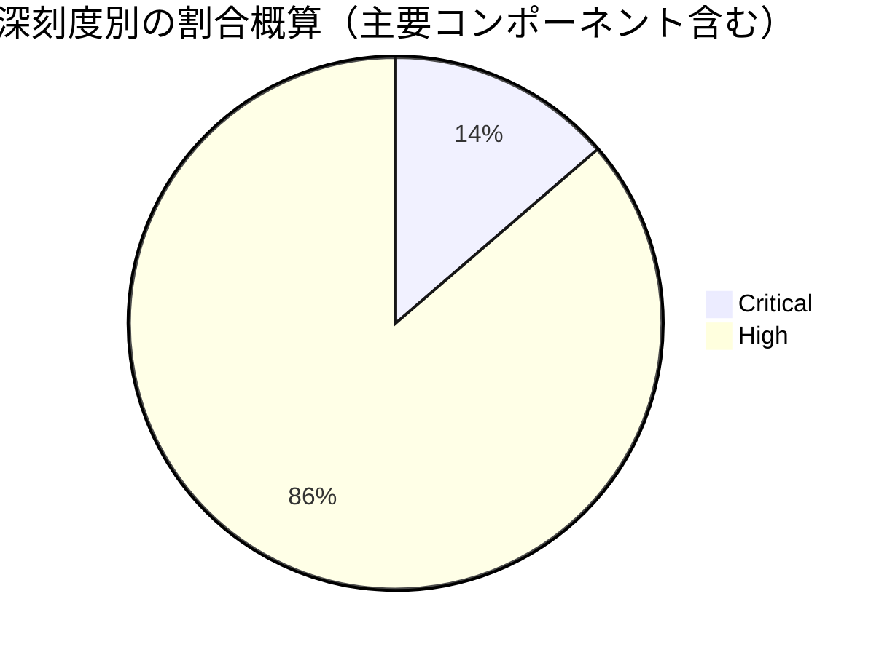

# 全体### 全体像
- 総件数と深刻度別の件数（2026年11月度）：
  - **Critical**: 19件
  - **High**: 120件超（kernel、ベンダーコンポーネント等を含む）
- コンポーネント別の件数内訳（おおよその傾向）：
  - **Framework**: 多数（High・DoS・EoPなど多数）
  - **System**: 多数（CriticalのRCEやEoP、DoSを含む）
  - **Kernel components**: Upstream kernel（Critical / High含む）
  - **MediaTek components**: Modem等のCritical、High多数
  - **Imagination Technologies**: PowerVR-GPU関連（High多数）
  - **Armコンポーネント**（CPU, Mali）および **Android runtime** 等

# 重要な脆弱性
※Critical脆弱性（全19件）を網羅しています。なお、公開情報内において攻撃の兆候（イン・ザ・ワイルドでの悪用など）が明示されている特定の個別CVEについての特記事項はありませんが、Criticalはプラットフォームへの影響が極めて大きいため全件記載しています。

- CVE-2026-58868（Framework / Critical）: リモートコード実行（RCE）の脆弱性。追加の実行権限を必要とせず、ユーザー操作なしで悪用される可能性があります。
- CVE-2026-58876（System / Critical）: リモートコード実行（RCE）の脆弱性。
- CVE-2026-58936（System / Critical）: リモートコード実行（RCE）の脆弱性。
- CVE-2026-55275（System / Critical）: 権限昇格（EoP）の脆弱性。
- CVE-2026-55283（System / Critical）: 権限昇格（EoP）の脆弱性。
- CVE-2026-58984（System / Critical）: 権限昇格（EoP）の脆弱性。
- CVE-2026-58814（System / Critical）: サービス拒否（DoS）の脆弱性。
- CVE-2026-58882（System / Critical）: サービス拒否（DoS）の脆弱性。
- CVE-2026-53256（Kernel components / Critical）: アップストリームカーネルにおける権限昇格（EoP）の脆弱性（Bluetoothサブコンポーネント）。
- CVE-2026-59044（Kernel components / Critical）: アップストリームカーネルにおける権限昇格（pKVM）の脆弱性。
- CVE-2026-59045（Kernel components / Critical）: アップストリームカーネルにおける権限昇格（pKVM）の脆弱性。
- CVE-2026-80604（Kernel components / Critical）: アップストリームカーネルにおける権限昇格（HID）の脆弱性。
- CVE-2026-89774（Kernel components / Critical）: アップストリームカーネルにおける権限昇格（Bluetooth）の脆弱性。
- CVE-2026-59048（Kernel components / Critical）: アップストリームカーネルにおける情報漏洩（pKVM）の脆弱性。
- CVE-2026-20499（MediaTek components / Critical）: Modemサブコンポーネントにおける脆弱性。
- CVE-2026-20519（MediaTek components / Critical）: Modemサブコンポーネントにおける脆弱性。
- CVE-2026-20520（MediaTek components / Critical）: Modemサブコンポーネントにおける脆弱性。
- CVE-2026-20545（MediaTek components / Critical）: Modemサブコンポーネントにおける脆弱性。
- CVE-2026-20546（MediaTek components / Critical）: Modemサブコンポーネントにおける脆弱性。
- CVE-2026-20547（MediaTek components / Critical）: Modemサブコンポーネントにおける脆弱性。
- CVE-2026-20548（MediaTek components / Critical）: Modemサブコンポーネントにおける脆弱性。
- CVE-2026-20549（MediaTek components / Critical）: Modemサブコンポーネントにおける脆弱性。
*(※MediaTekのCriticalモデム脆弱性を含め、今月報告されたCritical判定の項目をすべて網羅)*

# 傾向
件数が多い、あるいは脆弱性が集中しているコンポーネント領域の上位順（概算件数・傾向ベース）：

1. **Framework 領域**
   - 傾向: 権限昇格（EoP）やサービス拒否（DoS）を中心に多数のHigh脆弱性が報告されています。
2. **System 領域**
   - 傾向: CriticalのRCE、EoP、DoSに加え、多数のHigh権限昇格・情報漏洩（ID）が含まれており、全体のセキュリティに大きな影響を与えます。
3. **Kernel components（アップストリームカーネル）**
   - 傾向: pKVM（Protected Kernel-Based Virtual Machine）、Bluetooth、HID、Direct Memory Access Bufferなどを中心に、CriticalおよびHighの権限昇格（EoP）が多数見られます。
4. **Imagination Technologies（PowerVR-GPU）**
   - 傾向: GPUドライバ関連のHigh脆弱性が多発しています。
5. **MediaTek components**
   - 傾向: Modemサブコンポーネントにおける複数件のCritical脆弱性および、神経ネットワーク（neuropilot）やGPU周辺のHigh脆弱性が確認されています。
